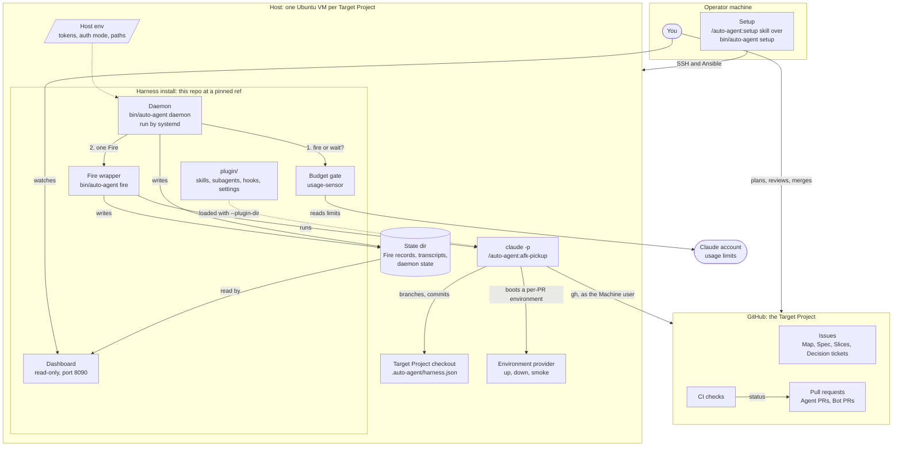
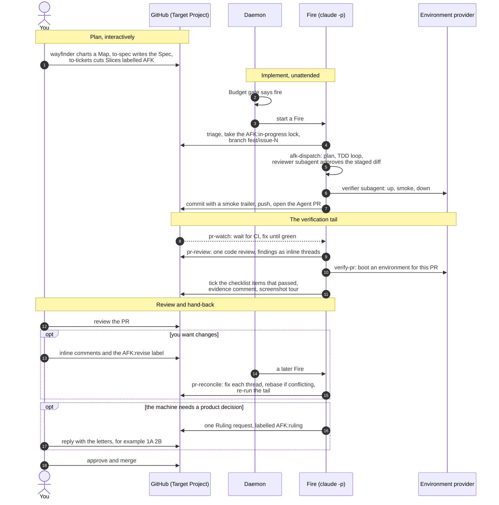
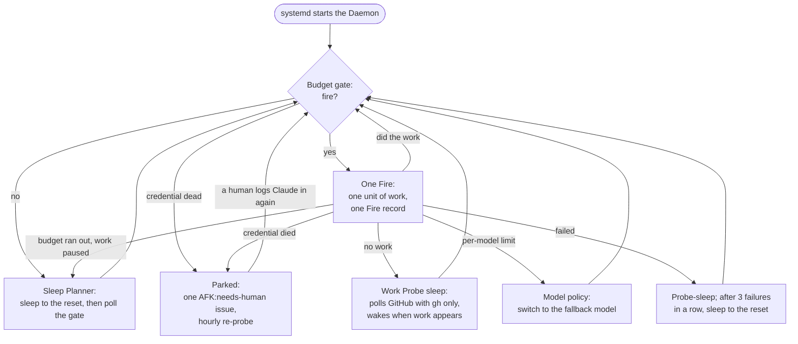
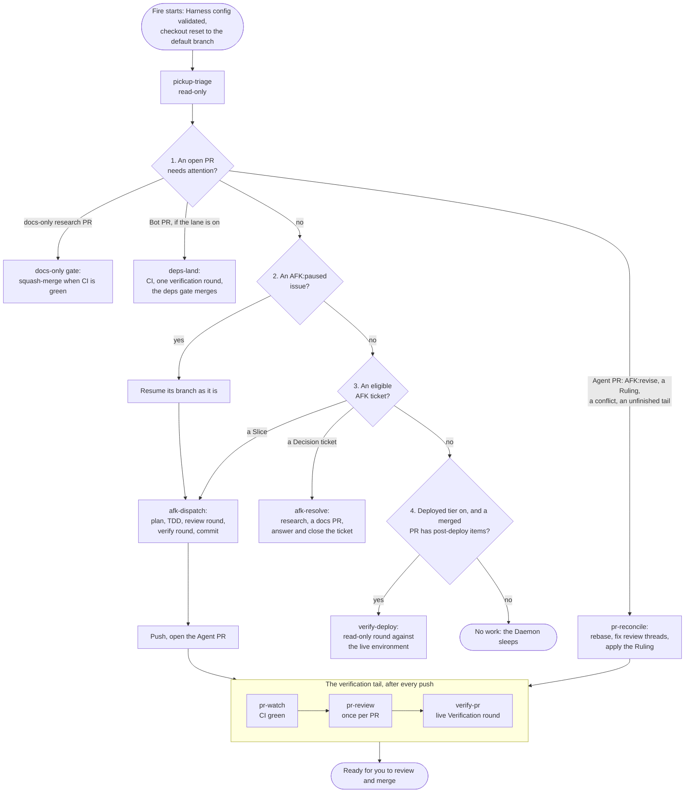
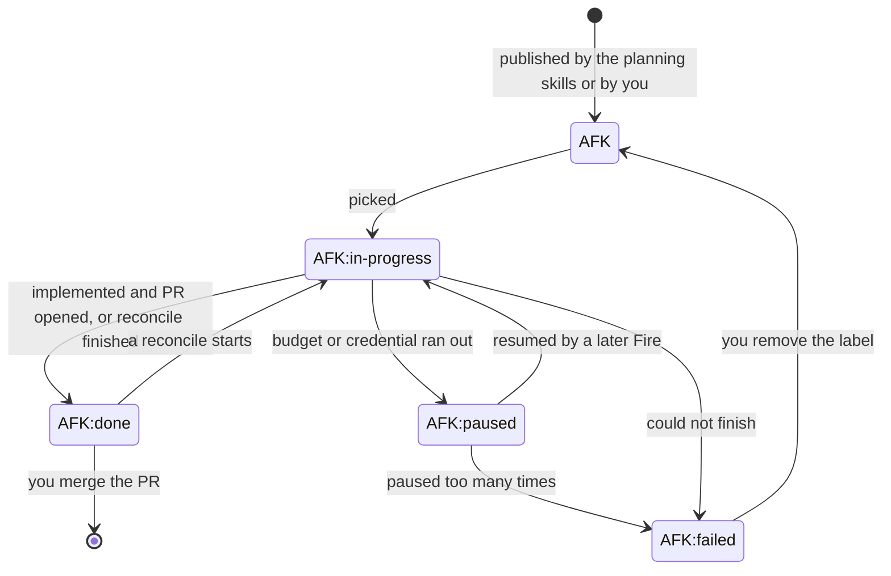

# auto-agent

A reusable autonomous agent harness. You plan work as GitHub issues; a Daemon
on a small VM picks up the ones labelled `AFK`, implements each test-first,
opens a pull request, and drives it to green, reviewed and verified live. You
review and merge. It was extracted from Smart-Smoker-V2 and can be pointed at
any repository.

The words with capitals (Daemon, Fire, Target Project, Host, Slice…) are the
project's vocabulary, defined in [`CONTEXT.md`](CONTEXT.md). Decisions are
recorded in [`docs/adr/`](docs/adr/).

**Contents**

- [How it works](#how-it-works): the architecture and the workflow, in diagrams
  - [The pieces](#the-pieces)
  - [From an idea to a merged PR](#from-an-idea-to-a-merged-pr)
  - [The Daemon's cycle](#the-daemons-cycle)
  - [One Fire, one unit of work](#one-fire-one-unit-of-work)
  - [Labels carry the state](#labels-carry-the-state)
  - [When it is your turn](#when-it-is-your-turn)
- [Getting started](#getting-started)
- [Where to read next](#where-to-read-next)
- Reference: [Layout](#layout) · [Harness config](#harness-config) ·
  [A Fire](#a-fire) · [The Budget gate](#the-budget-gate) ·
  [The Daemon](#the-daemon) ·
  [The Environment provider](#the-environment-provider) ·
  [The verification round](#the-verification-round) ·
  [The Deployed tier](#the-deployed-tier) ·
  [The deps-land lane](#the-deps-land-lane) · [Setup](#setup) ·
  [The Go binary](#the-go-binary)

## How it works

### The pieces

Three places are involved: your own computer (the Operator machine), the
repository being worked on (the Target Project, on GitHub), and one VM per
Target Project (the Host) where the Daemon runs.



| Piece | What it does |
| --- | --- |
| **Daemon** | The always-on loop: ask the Budget gate, run one Fire, sleep, repeat. One per Target Project per Host. |
| **Budget gate** | Decides fire-or-wait from the Claude account's real limits, so the Daemon paces itself by budget and not by clock. |
| **Fire** | One pass that does exactly one unit of work and writes one Fire record. Each starts from a clean checkout of the default branch. |
| **Plugin** | What a Fire's Claude session loads: the `/auto-agent:*` skills that are the playbooks, the subagents (reviewer, verifier, manual-verifier, implementer, arbiter), the gating hooks and the permission baseline. |
| **Harness config** | `.auto-agent/harness.json`, committed in the Target Project: everything the harness needs to know about that repo (pick signal, commands, Surfaces, provider). |
| **Host env** | `~/.config/auto-agent/env` on the Host: everything about the machine and the accounts (tokens, auth mode, paths). Never committed. |
| **Environment provider** | The Target Project's own `up` / `down` / `smoke` command. The harness calls it to boot an environment for one PR and verify the change live. |
| **State dir** | Where Fire records, transcripts and the Daemon's state live, outside the checkout. The Dashboard reads it. |
| **Dashboard** | A read-only status page per Host: Fire history, the queue, open Agent PRs, the Budget gate. |
| **Machine user** | The dedicated GitHub account the Daemon acts as. Never your own. |

### From an idea to a merged PR

The planning skills run interactively with you; everything between "ticket
published" and "PR ready" runs with nobody present.



The machine never merges an Agent PR. The only merges it makes are the
optional ones behind their own gates: a docs-only research PR, and a
Dependabot PR on the deps-land lane.

### The Daemon's cycle

The Daemon is a loop with no schedule. It fires whenever the Budget gate
allows, so a backlog drains inside one budget window, and it sleeps cheaply
when there is nothing to do or nothing left to spend.



A Fire that runs out of budget mid-ticket is paused, not failed: its partial
work is frozen in a `wip:` commit on its branch, the issue moves to
`AFK:paused`, and a later Fire resumes it. Details: [The Daemon](#the-daemon),
[The Budget gate](#the-budget-gate) and
[`docs/afk/autonomous-loop.md`](docs/afk/autonomous-loop.md).

### One Fire, one unit of work

Every Fire runs the same skill, `/auto-agent:afk-pickup`. It makes one
read-only triage call and then does exactly one thing: the first of these
that applies. Finishing what is already open always outranks starting
something new.



Where the tail can leave the straight path:

- **CI stays red**, or a Verification round keeps failing after its fix
  rounds: the PR becomes a draft labelled `AFK:checks-failed`. It is yours.
- **The review has findings**: they are posted as inline threads, the PR gets
  `AFK:revise`, and the Fire ends. The next Fire reconciles: the implementer
  fixes each thread or disputes it, and the Arbiter rules a dispute.
- **Something only a human can decide**: one consolidated Ruling request,
  labelled `AFK:ruling`. Your one-line answer is applied by the next Fire.
- **No Environment provider yet** (the Bootstrap state): no round can run, so
  the PR is labelled `AFK:verify-human` and you verify it by hand.

Inside a dispatch the roles are separated by tool allowlists and hooks, not by
prompts: the Fire's own session implements; the reviewer subagent cannot edit;
the verifier subagent can only read and run commands, and is the one that
lands the commit. See [`docs/afk/dispatch.md`](docs/afk/dispatch.md) and
[`docs/afk/roles.md`](docs/afk/roles.md).

### Labels carry the state

Nothing is remembered between Fires except what is on GitHub and in git. The
`AFK:*` labels on an issue are the state machine, and `AFK:in-progress` is
also the Single-flight lock: while any issue holds it, no other Fire works.



The labels on a pull request say who acts next; the full table of who sets
and clears each one is in
[`docs/afk/autonomous-loop.md`](docs/afk/autonomous-loop.md#label-taxonomy).

### When it is your turn

| You see | It means | You do |
| --- | --- | --- |
| An open Agent PR, green, no `AFK:*` label | The machine is finished with it | Review it. Approve and merge, or hand it back |
| You want changes | The machine works review threads, not top-level comments | Leave **inline** comments and apply `AFK:revise` |
| `AFK:revise` on a PR | A Fire will fix the open threads | Nothing |
| A conflicting PR | The next Fire rebases it | Nothing |
| `AFK:ruling` on a PR | A product decision is waiting for you | Reply to the Ruling request with one letter per decision: `1A 2B` |
| `AFK:verify-human` on a PR | No live round could vouch for it | Verify it by hand |
| A draft PR, or `AFK:checks-failed`, `AFK:revise-failed`, `AFK:rebase-failed`, `AFK:deps-failed` | Parked: the machine ran out of attempts and will not pick it again | Take it over, or fix the cause and clear the label |
| `AFK:failed` on an issue | The ticket could not be implemented; a comment says why | Triage it. Removing the label requeues it |
| An `AFK:needs-human` issue | The Daemon is Parked: its Claude credential died | Log Claude in again on the Host; it un-parks itself within the hour |
| `HITL` | Needs a live exchange with a human | The Daemon never picks it |

## Getting started

1. **Set up a Host.** From a clone of this repo, start Claude Code and run
   `/auto-agent:setup <target-checkout|owner/name>`. It interviews you, drafts
   the Target Project's Harness config as a PR, and turns a VM into a running
   Daemon and Dashboard. The three entry points (inside the VM, bring your own
   VM, provision on Proxmox) are under [Setup](#setup); what ends up on the
   machine is in [`docs/host.md`](docs/host.md).
2. **Plan some work.** In the Target Project, run `/auto-agent:wayfinder`,
   `/auto-agent:to-spec` and `/auto-agent:to-tickets`. They publish Slices
   labelled `AFK` on the pick signal the Harness config declares.
3. **Watch and review.** The Dashboard shows what the Daemon is doing. Agent
   PRs arrive on their own; [When it is your turn](#when-it-is-your-turn)
   says what each one needs from you.

To try the loop without writing to GitHub:

```sh
bash run-tests.sh                                   # every suite
bin/auto-agent check-config plugin/fixtures/target-project
AUTO_AGENT_STATE_DIR=/tmp/aa-state bin/auto-agent fire --dry-run   # the pick verdict, no write
```

## Where to read next

| You want to | Read |
| --- | --- |
| Learn the vocabulary | [`CONTEXT.md`](CONTEXT.md) |
| Understand the unattended loop end to end | [`docs/afk/index.md`](docs/afk/index.md), then [`docs/afk/autonomous-loop.md`](docs/afk/autonomous-loop.md) |
| See how one ticket is implemented | [`docs/afk/dispatch.md`](docs/afk/dispatch.md), [`docs/afk/roles.md`](docs/afk/roles.md) |
| Run and maintain a Host | [`docs/host.md`](docs/host.md), [Setup](#setup) |
| Write a Target Project's Harness config | [Harness config](#harness-config), [`plugin/fixtures/target-project/.auto-agent/`](plugin/fixtures/target-project/.auto-agent/) |
| Write an Environment provider | [`plugin/providers/CONTRACT.md`](plugin/providers/CONTRACT.md), [The Environment provider](#the-environment-provider) |
| Read the Dashboard or its JSON | [`dashboard/README.md`](dashboard/README.md) |
| Know why something is the way it is | [`docs/adr/`](docs/adr/) |
| Find a file | [Layout](#layout) |

The rest of this README is reference.

## Layout

- `bin/auto-agent`: the CLI engine Setup drives (ADR 0009).
  `check-config <target-dir>` validates a Target Project's Harness config;
  `show-config <target-dir>` prints the resolved JSON every lib reads;
  `fire [--dry-run | --resolve-dry-run <N>] [<target-dir>]` runs one Fire;
  `usage-sensor` prints the Gate verdict for the declared auth mode and
  `park` drives the parked state behind a dead credential;
  `daemon [<target-dir>]` is the Daemon the Daemon unit runs and
  `unit-render daemon|dashboard` renders its systemd units from the Host env;
  `dashboard` serves this Host's read-only status page and `/api/status`;
  `setup [<target-dir>]` runs Setup's fixed stages inside the Host and
  `check` its verify stage alone; `setup --host <user@vm>` runs them from the
  Operator machine over SSH, and `upgrade <name>` / `check <name>` reach that
  Host again through the Host inventory;
  `provider-check [--pr <N>] [<target-dir>]` drives a Target Project's
  Environment provider through its contract and prints one verdict;
  `surfaces`, `checklist`, `evidence`, `verify-boot` and `surface-launch` are
  the verification round's own commands, and `deployed` the Deployed tier's;
  `pick` is what the planning skills call to hand a ticket to the Daemon,
  in the shape of the Go binary's `pick` command; `pick-publish`,
  `labels-ensure` and `vendored-skills` are the libs it and Setup call.
- `lib/`: the bash libs the Daemon runs from, each with a `*.test.sh` suite.
  `harness-config.sh` is the only reader of `.auto-agent/harness.json`;
  `host-env.sh` reads the Host env; `fire.sh` is the Fire wrapper;
  `rate-limits-tap.sh` records the stream's rate-limit events;
  `fire-record.sh` writes the Fire record; `usage-sensor.sh` is the Budget
  gate's one sensor, chosen per auth mode; `exhaustion-classifier.sh` reads
  how a Fire ended; `daemon-park.sh` parks and un-parks the Daemon on
  credential death; `daemon.sh` is the Daemon: the gate, the Fire and the
  Sleep Planner, cycle after cycle (`sleep-planner.sh`); `unit-render.sh`
  renders the systemd units; `runbook-check.sh` asserts the plugin's skills
  still carry their load-bearing rules and no Target Project literal;
  `pick.sh` is `pick add|remove|labels` over the next two until the cut-over;
  `pick-publish.sh` puts an AFK ticket on (or takes it off) whatever pick
  signal the Harness config declares; `labels-ensure.sh` creates the harness
  labels create-if-missing; `vendored-skills.sh` checks and syncs the vendored
  upstream skills against their pinned commit; `provider-check.sh` is the
  Provider check, the conformance run behind the Environment provider
  contract, over `provider-contract.sh`, the one implementation of ADR 0003's
  driving rules that the check and a round's boot share; the verification
  round's libs are `surfaces.sh` (which Surfaces a
  diff touched, which earn a tour, at what viewport), `checklist.sh` (the PR
  body's items, and the tick of the ones that passed), `evidence.sh` (the
  round's evidence sink), `display-env.sh` (display truth and the Electron
  sandbox mode), `surface-launch.sh` (the launcher a Surface's kind selects)
  and `verify-boot.sh` (the environment and its apps, up and down);
  `deployed-tier.sh` is the Deployed tier (its lane gate, the deferred items,
  the merged PR it works next, and the live `status` block).
  `testdata/` holds canned streams.
- `plugin/`: the Claude Code plugin a Fire loads with `--plugin-dir` (ADR 0001).
  `.claude-plugin/plugin.json` is the manifest; `skills/` the namespaced
  `/auto-agent:<name>` skills (the core lane: `afk-pickup`, `afk-dispatch`,
  `pr-watch`, `pr-review`, `pr-reconcile`; the resolve lane: `afk-resolve`;
  the verification round: `verify-pr`; the Deployed tier: `verify-deploy`;
  Setup's conversation: `setup`; the planning skills: `wayfinder`, `to-spec`,
  `to-tickets`; the vendored upstream skills `research`, `grilling` and
  `domain-modeling`, copied from mattpocock/skills at the commit
  `vendored-skills.json` pins; plus the no-op `dry-run`);
  `agents/` the `auto-agent:implementer`, `auto-agent:reviewer`,
  `auto-agent:verifier` and `auto-agent:manual-verifier` subagents; `hooks/`
  the `smoke-trailer` and `review-gate` Stop hooks and the `caveman`
  UserPromptSubmit hook, which asks a Fire (and only a Fire) for terse prose
  and is turned off by `AUTO_AGENT_CAVEMAN=off` in the Host env;
  `settings/baseline.json` the `--settings` baseline (env, permissions, deny
  list) every Fire carries;
  `schema/` holds the Harness config JSON schema and its jq validator;
  `fixtures/target-project/` is the fixture Target Project the harness tests
  itself against; `providers/` is what a maintainer writing an Environment
  provider gets: `CONTRACT.md`, the sourceable `provider-lib.sh` and the
  compose reference provider (the fixture's `verify/provider` is the
  single-process one).
- `dashboard/`: the Dashboard (`server.py`, stdlib Python, and `index.html`);
  its README documents the `/api/status` shape and its Host env keys.
- `infra/systemd/`: the Daemon and Dashboard unit templates Setup installs.
- `infra/ansible/`: the configure step every Setup entry point converges on
  (`configure.yml` and the `host` role: base needs, display, Electron
  sandbox, Host env, units); `lib/setup.sh` is the engine that runs it.
  `install.yml` is the remote entry point's play (`lib/setup-remote.sh`): the
  Harness install at its ref, the secrets handoff and optional tailscale.
- `infra/terraform/`: the Proxmox Provisioner (`proxmox/`, the environment
  `lib/setup-provision.sh` applies, over `modules/proxmox-vm`, ported from
  Smart-Smoker-V2's VM module).
- `infra/cutover/`: what moves a Host from a repo-owned daemon onto a Harness
  install: `parity-gate.sh` (run before the old daemon stops) and
  `soak-check.sh` (run before the rollback window ends). The runbook for the
  first one is `docs/runbooks/cutover-smart-smoker.md`.
- `docs/`: the decisions (`adr/`), the operator pages for the AFK loop
  (`afk/`) and for a Host (`host.md`), and the runbooks (`runbooks/`).
- `infra/e2e/`: the end-to-end test (`proxmox-e2e.sh`): a throwaway Proxmox
  VM, unattended Setup against the fixture, one green Fire, a healthy
  `/api/status`, the VM destroyed. Run by hand; the runbook is
  `docs/runbooks/e2e-proxmox.md`.
- `cmd/auto-agent`, `internal/`, `go.mod`: the Go Daemon, built beside the
  bash one until each Lane is cut over (ADR 0014). See
  [The Go binary](#the-go-binary).
- `run-tests.sh`: runs every `*.test.sh` and `*.test.py` suite; the one entry
  point CI calls.

## Harness config

A Target Project commits one `.auto-agent/` directory (ADR 0002):
`harness.json` for the machine, validated against
`plugin/schema/harness.schema.json` at Setup and before every Fire, and
fixed-name markdown siblings (`verifier-runbook.md`, `bot-pr-checklist.md`,
`deployed-checks.md`) for prose. An optional executable `host-extension` adds
project-specific Host needs at Setup time. The default branch is detected from
GitHub, never declared. See `plugin/fixtures/target-project/.auto-agent/` for
a complete example.

```sh
bin/auto-agent check-config plugin/fixtures/target-project
bash run-tests.sh
```

## A Fire

`bin/auto-agent fire` runs one Daemon pass against a Target Project: it
validates the Harness config (failing closed), resolves it once and exports it
as `HARNESS_CONFIG_JSON` for every lib and skill inside the Fire, resets the
checkout to the tip of the detected default branch, runs `claude -p` with
`--plugin-dir plugin`, `--settings plugin/settings/baseline.json` and
`--output-format stream-json`, pipes the stream through the rate-limit tap,
and writes a Fire record when the Fire ends, failed ones included. The
baseline carries the env, permissions and deny list a plugin cannot; the
Target Project's own `.claude/settings.json` merges on top of it, and the
deny list binds even though a Fire runs with permissions bypassed. Everything
lands in the State dir, `AUTO_AGENT_STATE_DIR` from the Host env
(`~/.config/auto-agent/env`), defaulting to `~/.local/state/auto-agent`:

- `fires/<fire-id>.json`: the Fire record (start, kind, issue, exit, plugin
  loaded, result, last rate-limit event, outcome, Gate verdict). Written once
  before claude runs (`endedAt` and `exit` null: the Fire in flight) and again
  when it exits. The Dashboard's input.
- `daemon-state.json`: what the Daemon is doing now (state, the log line, the
  reset it sleeps to, the fail count), rewritten at every step so the
  Dashboard never parses the journal.
- `rate-limits.json` / `rate-limits.jsonl`: the last and every
  `rate_limit_event` the tap saw (ADR 0008 addendum).
- `usage-sensor.json`: the usage sensor's memory (the last good endpoint
  verdict for the stale hold, the 403 mark, the model switch and its reset).
- `parked.json`: present while the Daemon is parked on a dead credential.
- `logs/<fire-id>.stream.jsonl` and `.stderr.log`: the raw transcript.

The prompt is `/auto-agent:afk-pickup`, the core lane's entry skill: one unit
of work per Fire, in strict order (reconcile an Agent PR that needs attention,
resume paused work, pick the next `AFK` ticket, route a Decision ticket), then
`/auto-agent:afk-dispatch` implements the pick as a single-agent implementer
with a TDD loop and the reviewer and verifier subagents, and the pickup skill
opens the PR and drives it through `/auto-agent:pr-watch` (CI), the one-time
`/auto-agent:pr-review` and the verification round. An Agent PR is never
merged by the machine. Every skill reads the repo, the default branch, the
commit scopes, the commands and the round caps from the Harness config;
`bin/auto-agent runbook-check` fails the suite if a skill regains a repo slug,
a `master`, a port or an app name, or loses a load-bearing rule.

The wrapper scrapes the skill's stable lines (`picked:   #N`, `picked:
reconcile PR #P (issue #N)`, `resolve: #N`, `afk-pickup: no eligible issue`,
`afk-pickup: skip …`) into the record's `work` block, prints
`AGENT_RUN_NO_WORK=1` when the queue was empty so the Daemon sleeps out the
window, and classifies every non-zero exit through the exhaustion classifier
(`lib/exhaustion-classifier.sh`), whose verdict the record carries as
`outcome`. A `rejected` rate-limit event tapped during the Fire is the
authoritative signal; the documented limit strings (`You've hit your
session/weekly/<model> limit … resets …`) stay as the text-mode fallback;
`authentication_failed` is credential death. An EXHAUSTED Fire is paused,
not failed: a pick freezes partial work in a `wip:` commit and moves its lock
`AFK:in-progress` to `AFK:paused` (the branch stays for resume), a reconcile
restores `AFK:done`, a resolve drops its lock and research branch so the next
Fire restarts it; the wrapper prints `AGENT_RUN_RESET_AT=<iso>` and exits 0.
When the limit was per-model it prints `AGENT_RUN_MODEL_LIMIT=<scope>` and an
empty reset instead, so the Daemon re-gates at once and the next verdict
switches the model rather than sleeping out a week.
An AUTH_DEAD Fire is paused the same way and parks the Daemon (below), with
`AGENT_RUN_AUTH_DEAD=1`. A FAILED Fire clears the lock it took (a pick goes
`AFK:in-progress` to `AFK:failed` with a comment; a reconcile restores
`AFK:done`).

## The Budget gate

`bin/auto-agent usage-sensor` is the Budget gate's one sensor, chosen per
auth mode and never guessing (ADR 0008 and addendum; the clock-based time
proxy is gone). It reads `CLAUDE_AUTH_MODE` from the Host env, cross-checks
it against the secrets present and `claude auth status` (failing loud with
exit 5 on a mismatch), and prints one Gate verdict: `authMode`, `sensor`
(`usage-endpoint | stream-events | limit-strings | spend | none`), `state`
(`ok | stale | unavailable | auth-dead`), `remainPct`, `resetAt`,
`shouldFire` (always a boolean), `observedAt`, `limits[]` (`scope` is
`session`, `weekly` or a model family, `utilization`, `resetsAt`),
`warnings[]`, plus `fireModel` and `fireModelUntil` from the model policy.
The Daemon fires on `shouldFire` and hands the verdict to the Fire through
`AUTO_AGENT_GATE_VERDICT_FILE`, so the same object lands in the Fire record's
`gate` block; the Dashboard shells to the sensor rather than re-implementing
it.

- **`login`**: the usage endpoint is the pre-Fire sensor. A 429, 5xx or
  network failure keeps the last good verdict as `stale` for 60 minutes
  (`AUTO_AGENT_GATE_STALE_MAX_SECS`); beyond that, and after a 403 (which
  marks the endpoint unavailable for the Daemon process,
  `AUTO_AGENT_DAEMON_ID`), the Host behaves like a setup-token Host.
- **`setup-token`**: fires optimistically. The last tapped `rate_limit_event`
  seeds the verdict (`stream-events`, `stale`, `observedAt` from that Fire,
  the unnamed per-model window keyed to the model that fired); a `rejected`
  event on an account window sets `resetAt` and holds the Fire until then; the
  last Fire's limit-string outcome does the same when it is newer. With no
  un-expired limit verdict the sensor is `none` and `shouldFire` is true.
- **`api-key`**: accepted by the schema, refuses to start (exit 6, sensor
  `spend`) until spend pacing exists.

Every Fire runs on the latest Opus (`--model opus`, claude's alias for the
newest Opus) at `--effort medium`; `AUTO_AGENT_FIRE_MODEL` and
`AUTO_AGENT_FIRE_EFFORT` in the Host env override either. Per-model limits
never gate. Under the model policy (`AUTO_AGENT_MODEL_PRIMARY`, default
`opus`; `AUTO_AGENT_MODEL_FALLBACK`, default empty, which never switches and
lets the Fires wait for the reset; `AUTO_AGENT_MODEL_SWITCH_PCT`, default 95)
a spent primary sets `fireModel`, the wrapper passes it as `--model` unless
`AUTO_AGENT_FIRE_MODEL` pins one, and the switch is remembered in
`usage-sensor.json` until the limit's reset. `AUTO_AGENT_GATE_MIN_PCT`
(default 25) is the fire threshold.

**Credential death** (401 from the endpoint, `claude auth status` exiting 1,
or `authentication_failed` in a Fire) is never exhaustion: the sensor exits 4
with `state: auth-dead`, and the Daemon **parks** (`bin/auto-agent park`):
`parked.json` in the State dir, one reused `AFK:needs-human` issue open in the
Target Project (matched by its body marker), `park reprobe` re-probing
`claude auth status` hourly and un-parking (closing the issue) when it
passes, so re-running `/login` over SSH is the whole fix. A Fire that dies
on its credential is paused like an exhausted one and parks itself.

```sh
CLAUDE_AUTH_MODE=login bin/auto-agent usage-sensor | jq .
bin/auto-agent park status
bin/auto-agent park reprobe
```

`fire --dry-run` prompts `/auto-agent:afk-pickup --dry-run`, against the
fixture Target Project when no target is given: the skill reaches its pick
verdict and prints `afk-pickup: would-pick #N …` (or `no eligible issue`)
without a GitHub or git write, and the wrapper exits 0 only when the stream's
init event lists the plugin and the skill and such a line was printed. It is
the Fire seam Setup's verify stage and the harness's own tests demo on.
`fire --noop` runs the no-op `/auto-agent:dry-run` skill instead, which proves
the plugin loads without touching GitHub at all.

`fire --resolve-dry-run <N>` prompts `/auto-agent:afk-resolve --issue <N>
--dry-run`, the resolve lane's dry run: it reads Decision ticket `<N>` and its
Map, runs the vendored `research` skill and writes the findings file under the
config's research prefix in the checkout, with no GitHub or git write (no
claim, branch, PR, comment or close), and ends on `afk-resolve: would-open PR
research/<slug> (<path>)`. Any `wayfinder:research` ticket with a Map parent
will do, closed ones included. A real resolve Fire is what `/auto-agent:afk-pickup`
runs when the pick is a Decision ticket: research, a `research/<slug>` branch,
a `docs(research): …` PR driven green by `/auto-agent:pr-watch`, the docs-only
gate's own merge command, the resolution comment, the close, the Map append
and fog graduation. A resolve is never paused: the wrapper restarts it.

The planning skills (`/auto-agent:wayfinder`, `/auto-agent:to-spec`,
`/auto-agent:to-tickets`) run interactively against any Target Project and
publish through the same Harness config: `auto-agent pick labels` creates
the harness labels, and `auto-agent pick add <N>` puts a ticket on the pick
signal, Project plus Priority when the `pick` block names a Project, then the
`AFK` label; `pick remove <N>` takes both off. The Go binary and
`bin/auto-agent` both answer the call.

```sh
AUTO_AGENT_STATE_DIR=/tmp/aa-state bin/auto-agent fire --dry-run
AUTO_AGENT_STATE_DIR=/tmp/aa-state bin/auto-agent fire --resolve-dry-run 3
AUTO_AGENT_STATE_DIR=/tmp/aa-state bin/auto-agent fire --noop
bin/auto-agent runbook-check
bin/auto-agent vendored-skills check --upstream
bin/auto-agent provider-check plugin/fixtures/target-project
```

## The Daemon

`bin/auto-agent daemon` is the Daemon: one per Target Project per Host, run by
systemd from the Harness install, knowing the Target Project only through the
Host env (`AUTO_AGENT_TARGET_DIR`) and the Harness config each Fire loads.
Each cycle reads the Gate verdict from `usage-sensor`, keeps it as
`gate-verdict.json` in the State dir and hands it to the Fire
(`AUTO_AGENT_GATE_VERDICT_FILE`), then:

- fires (`bin/auto-agent fire`, one Fire record per Fire) when the verdict
  says so, and goes straight back to the gate after a clean Fire;
- sleeps to the verdict's reset when it does not, then polls the gate (the
  Sleep Planner, carried over unchanged);
- after an empty queue (`AGENT_RUN_NO_WORK=1`) sleeps in Work Probe chunks
  and wakes early when work appears; after an exhausted Fire sleeps to the
  Fire's reset; after a per-model limit re-gates at once so the model policy
  switches; after a failed Fire probe-sleeps, going deaf to the reset after
  `AUTO_AGENT_DAEMON_FAIL_CAP` (3) failures in a row;
- on a dead credential parks, then only re-probes hourly until `/login` is
  re-run; on a mode mismatch holds off and re-gates hourly; in api-key mode
  exits 6 and stays down.

Within the Target Project the `AFK:in-progress` label is the single-flight
lock; a `flock` on `daemon.lock` in the State dir stops a second Daemon on the
same State dir (exit 7). The Daemon writes nothing into the checkout.

`bin/auto-agent unit-render daemon|dashboard [--out <dir>]` renders
`infra/systemd/auto-agent-<name>.service.in` from the Host env: `User` from
`AUTO_AGENT_HOST_USER`, `EnvironmentFile` the Host env itself, `ExecStart`
from this install, `PATH` from `AUTO_AGENT_UNIT_PATH`, `MemoryMax` from
`AUTO_AGENT_MEMORY_MAX` (8G) and `AUTO_AGENT_DASHBOARD_MEMORY_MAX` (512M).
Setup's configure step installs the result; `systemd-analyze verify` passes on
both. `AUTO_AGENT_FIRE_MODEL` in the Host env pins every Fire's model and so
overrides the model policy's switch; leave it unset for the latest Opus (or
the gate's switch, when a fallback is configured). `AUTO_AGENT_FIRE_EFFORT`
sets the Fire's effort (default `medium`).
The Dashboard unit runs `bin/auto-agent dashboard` (see
[`dashboard/README.md`](dashboard/README.md)): it binds
`AUTO_AGENT_DASHBOARD_BIND` (loopback by default) on
`AUTO_AGENT_DASHBOARD_PORT` (8090), and `AUTO_AGENT_DASHBOARD_SUMMARY=off`
turns off the Haiku summary of the Fire in flight.

```sh
AUTO_AGENT_STATE_DIR=/tmp/aa-state AUTO_AGENT_DAEMON_FIRE_ARGS=--dry-run \
    DAEMON_MAX_CYCLES=1 bin/auto-agent daemon plugin/fixtures/target-project
bin/auto-agent unit-render daemon --out /tmp/aa-units
systemd-analyze verify /tmp/aa-units/auto-agent-daemon.service
```

## The Environment provider

A Target Project brings its own environment behind one executable with
`up --pr N`, `down --pr N` and `smoke` (ADR 0003); the harness owns the round.
The whole contract, its exit codes and every verdict the check can print are
in [`plugin/providers/CONTRACT.md`](plugin/providers/CONTRACT.md), beside the
two reference providers and `provider-lib.sh`.

`bin/auto-agent provider-check [<target-dir>]` is the conformance run: it drives
`down`, `up --pr N`, the key block, the declared Surfaces' `url_key`s, `smoke`
and `down` again, and prints one verdict. It answers "does my provider
conform" with no checklist round, no PR and no Claude, which is what Setup's
verify stage asks and what a maintainer writing a provider iterates against.
A Target Project with no hermetic block at all is in the Bootstrap state
(exit 3): the Daemon still works its tickets, and the provider is the first
thing it is asked to write.

## The verification round

`/auto-agent:verify-pr` is one manual-verification round against an open Agent
PR: the PR's checklist parsed, the environment booted through the Environment
provider, every unchecked item exercised on the declared Surfaces by the
`auto-agent:manual-verifier` subagent, a screenshot tour of every touched UI
Surface posted into the PR description, the boxes that passed ticked, one
evidence comment, and the terminal line the caller reads:

```
manual-verify: <pass>/<total> PASS, <deferred> deferred, <fail> FAIL
screenshots: <n> posted | PARTIAL — <n>/<total> | SKIPPED — <reason> | none (no UI Surface touched)
```

The round reads `.auto-agent/harness.json` from the **PR head** (ADR 0007), so
a PR that adds an Environment provider is verified by the provider it adds:
every round command takes `--head`, which reads the checkout the round is
standing in rather than the config the Fire resolved from the default branch
and exported. The ADR 0003 driving rules themselves (the `down` before the
first `up`, the one retry, the block grammar, the `url_key`s) live in
`lib/provider-contract.sh`, which the Provider check and the round's boot both
call, so the check and the round cannot drift apart about what conformance is.

What the harness owns, and the Target Project only declares:

- **which Surfaces a diff touched** — `bin/auto-agent surfaces touched --pr <N>`
  matches the changed paths against each Surface's `paths` globs;
- **which of them earn a screenshot tour** — `surfaces tour` narrows that to the
  `browser` and `electron` kinds, which ALWAYS earn one when touched; `cli` and
  `api` Surfaces are evidence-only (ADR 0003), and no declaration can opt a UI
  Surface out;
- **the capture shape** — `surfaces viewport <name>`, from the Surface's
  `viewport` (a project whose users hold a phone or watch a fixed panel declares
  that shape; the default only keeps a tour from having no shape at all);
- **the checklist protocol** — `checklist parse` reads the unchecked items of
  the two verification sections, `checklist tick` flips only the ones that
  passed, never un-ticks, and never touches a checkbox elsewhere in the body;
- **the evidence sink** — `evidence dir --pr <N> --round <M>` is the round's
  directory in the State dir, `evidence name`/`shots` the screenshot naming, and
  `evidence inject` rewrites the PR body's `## Screenshots` section in place, so
  a re-verify round refreshes the tour instead of stacking a new copy;
- **the boot** — `verify-boot up --pr <N> [--surface <name>]... --head` runs `down`
  before the first `up`, retries a failed boot exactly once, checks the block
  and every declared `url_key`, launches the app of each `electron` Surface, and
  prints the block the round exports. `verify-boot down --pr <N>` is the
  teardown that runs on every exit path;
- **the launchers** — `surface-launch mcp <surface>` is what an MCP entry
  points at, and the Surface's kind chooses what it becomes: a headful browser
  on the Host display with a fresh profile per run, or an attach to the app's
  debugging endpoint. `surface-launch mcp-config` renders that registry from
  the config — Surface names are per Target Project, so it cannot be a static
  file — and the Fire wrapper passes it to every session as `--mcp-config`.

Display truth is a plain `DISPLAY` in the Host env — Xvfb on the reference Host
(ticket #19), no session globbing, and never a headless fallback: no display is
an infra finding the round reports. On a Host that restricts unprivileged user
namespaces, an `electron` Surface's app needs an AppArmor profile granting them
to its binary (Setup writes it). Without one the app starts with
`ELECTRON_DISABLE_SANDBOX=1` and the round says `sandbox: DEGRADED — …`, in the
block, the evidence comment and the result line: degraded is reported, never
silent, and never a reason to skip the round.

```sh
printf 'app/server.py\n' | bin/auto-agent surfaces tour plugin/fixtures/target-project
bin/auto-agent verify-boot up --pr 0 plugin/fixtures/target-project
bin/auto-agent verify-boot down --pr 0 plugin/fixtures/target-project
```

## The Deployed tier

A hermetic round defers what only a real deployment can prove, and demands a
`<!-- post-deploy: … -->`-tagged checklist item for it. The Deployed tier runs
those items after the PR merges, read-only, against a live environment, when
the Target Project declares it:

```json
"verification": {
  "hermetic": { "command": "verify/provider", "smoke": true },
  "deployed": { "command": "verify/provider", "enabled": true }
}
```

The lane is on only when the block exists and `enabled` is not false (an
omitted `enabled` is on). Declared with `enabled: false`, every Fire record
carries the note `deployed-lane: off — verification.deployed.enabled is false`
in its `notes`; not declared, the lane is never asked and no merged PR is ever
listed. It is optional, so it only fills a Fire that would otherwise be idle:
the pickup triage's `deployed` verdict names the oldest merged Agent PR with
unchecked post-deploy items, a round left under `rounds.manual_verify`, and
30 minutes (`DEPLOYED_TIER_WAIT_MINS`) since it merged and since its last
round — time for its deploy to land, and no spending every round inside one
Daemon cycle.

`/auto-agent:verify-deploy` is the round: the same checklist protocol, verifier
core and evidence sink as `verify-pr`, over the deferred items only. The
deployed command resolves its own targets and answers `status` with the same
`KEY=value` block (exit 0 healthy, 1 unhealthy, 3 prerequisite missing); the
tier calls `status` and **never `up` or `down`**. One comment per round, headed
`### Deployed verification — round <M>/<MAX>`, and one terminal line:

```
deployed-verify: <pass>/<total> PASS, <deferred> deferred, <fail> FAIL — round <M>/<MAX> [— EXHAUSTED]
```

```sh
bin/auto-agent deployed lane plugin/fixtures/target-project     # off: the fixture ships enabled false
bin/auto-agent deployed items body.md                           # the deferred items of a PR body
bin/auto-agent deployed pick|status <target-dir>                # the next merged PR; the live block
```

The Go Daemon derives the same Lane, last after reconcile, resume and the
pick (`state` and `next` are `deployed` in a dry run). Go calls the deployed
command's `status` alone, from the default branch's checkout; a status that
is not healthy, or a block missing a declared Surface's `url_key`, is an
infrastructure error with no item verdict, and the round still counts. A
read-only Verify Step, with no tool that edits, runs the deferred items
against that block; Go ticks what passed in the PR's body and posts the
round's one comment, and a failed item is reported there, never fixed: the PR
is merged. The round takes no lock. The Fire record carries it as `deployed`,
its `line` the `deployed-verify:` line, and the off note in `notes`.

## The deps-land lane

Dependabot PRs land behind their gate, with no human, when the Target Project
declares a `dependabot` block:

```json
"dependabot": { "enabled": true }
```

The lane is on only when the block exists and `enabled` is not false. Without
it, the pickup triage never hands a Fire a Dependabot PR and the reconcile
order skips them. With it, a Bot PR ranks below every Agent PR, and
`/auto-agent:deps-land` drives one per Fire to a terminal state:

1. retitle a security bump `fix(deps):` (`deps-lane retitle`);
2. append the Target Project's `bot-pr-checklist.md` sibling to the PR body,
   verbatim, inside the harness's `<!-- bot-pr-checklist v1 -->` markers. The
   file must carry at least one `- [ ]` item under a `## Manual verification`
   heading, or the lane refuses it;
3. Tier A: CI green through `/auto-agent:pr-watch --bot`;
4. Tier B: one `/auto-agent:verify-pr --force-tour` round, passing only at
   `n/n PASS, 0 deferred, 0 FAIL`;
5. the deps gate (`bin/auto-agent deps-gate`), whose approving verdict carries
   the shared admin-squash merge command the pickup skill runs, checked
   against the config's `required_checks`.

Either tier's failure spends one fix attempt from a budget of
`rounds.deps_fix` in total, counted from sha-keyed marker comments on the PR so
a crash never refunds one; a fix commit carries `[dependabot skip]`, and a
conflicting bump is either nudged (`@dependabot rebase`) or rebased by the
Rebase Driver with the config's `commands.lockfile_refresh`. When the budget is
spent the PR is parked (drafted, labelled `AFK:deps-failed`, commented once)
by `deps-lane park`, whichever tier ran out. A major bump is never merged on
machine evidence: it gets `HITL` and waits for an approving review.

```sh
bin/auto-agent deps-lane lane plugin/fixtures/target-project    # off: the fixture declares no block
bin/auto-agent deps-lane inject-checklist [<checklist>] < body  # the body with the checklist unit
bin/auto-agent deps-lane park <pr> <sha> "<last failure>"       # the idempotent exhaustion park
```

## Setup

The front is a skill: start Claude Code in a clone of this repo and run

```
/auto-agent:setup <target-checkout|owner/name> [--host <user@vm|name> | --provision proxmox --name <name>]
```

It reads the Target Project, interviews you for the Surfaces and the hermetic
tier (one question at a time, each with a recommended answer), drafts
`.auto-agent/harness.json` and the body of the PR that proposes it, validates
the draft with `bin/auto-agent check-config --draft <file>`, shows you the
engine command, then runs it and explains each stage line; a failed stage is
explained from the engine's output with the next command to run. The skill
never writes to a Host: every write is the engine's. It never asks for a
secret in the conversation either: you save each one to a 0600 file and give
it the path. `--draft-only` stops after the draft (no Host, no GitHub write);
`--answers <file>` answers the interview unattended.
`/auto-agent:setup check <name>` and `upgrade <name>` drive those commands.

The engine underneath runs the same way without the skill.
`bin/auto-agent setup [options] [<target-dir>]` turns a Target Project plus the
Host it runs in into a running Daemon and Dashboard (ADR 0009). This is the
in-VM entry point: clone this repo inside an Ubuntu 24.04 VM (26.04 is
accepted too; that checkout is the Harness install), log Claude in there (`claude auth login`, the entry
point's precondition), mint the machine user's classic PAT in a browser, and
run:

```sh
bin/auto-agent setup --gh-login <machine-user> --gh-token-file <pat-file> ~/src/<project>
```

The stages are fixed and stop at the first failure, each printing one
`setup: <stage>: ok|changed|skipped|FAIL — <detail>` line:

1. **baseline**: Ubuntu 24.04, the reference, or 26.04 (the distribution is
   asserted first), x86_64 or
   arm64, systemd, passwordless sudo, outbound internet, and one Daemon per
   Target Project on this Host.
2. **doctor**: the commands this machine needs (`git gh jq curl python3 claude
   ansible-playbook`), each missing one named with its install command. Setup
   never installs them itself.
3. **github**: the PAT is the expected machine user's, a classic PAT with
   `repo, project, workflow`, and admin on the repo (ADR 0005).
4. **claude**: `claude auth status` agrees with the declared auth mode
   (`login`, or `setup-token` with `--claude-token-file`); `api-key` refuses.
5. **config**: the checkout (cloned with `--repo` when missing) commits as the
   machine user; a missing `.auto-agent/harness.json` is proposed as a PR from
   `auto-agent/harness-config`, opened by the machine user (the `--config`
   draft, else a label-only skeleton; the `--config-pr-body` file as its
   body, else a review checklist). The Daemon is enabled anyway: its
   preflight fails closed until the PR merges.
6. **configure**: `infra/ansible/configure.yml` over this Host, with base needs
   derived from the Harness config: a `browser` Surface brings Xvfb on a fixed
   `DISPLAY` (`:99`), the reference fonts, Node and Google Chrome; an
   `electron` Surface the display, the Electron runtime libraries and an
   AppArmor profile granting user namespaces to its launcher and Electron
   binary (`AUTO_AGENT_ELECTRON_BINARY` overrides the default
   `<checkout>/**/node_modules/electron/dist/electron`); `host.docker` Docker.
   A Host that already resolves a working `docker compose`, or `node` and
   `npx`, on the units' PATH (`AUTO_AGENT_UNIT_PATH`) keeps its own: the role
   installs neither over it, and the stage line says `kept this Host's own`.
   It writes the Host env (0600, `no_log`), the State dir and the Daemon and
   Dashboard units (`unit-render`). Its log is `setup/configure-<time>.log` in
   the State dir.
7. **extension**: the Target Project's `.auto-agent/host-extension`, when it
   has one, run as the Host user from the checkout with one argument (`setup`,
   or `upgrade` on an upgrade)
   and no secret in its environment. It must be idempotent; a non-zero exit
   stops Setup before the Daemon starts.
8. **verify**: `bin/auto-agent check` (below).
9. **enable**: both units enabled and started, or restarted when configure
   changed anything.
10. **bootstrap**: the bootstrap issue, when the config declares no hermetic
    tier.
11. **summary**: every stage's line, the Dashboard's address, then
    `setup: converged — nothing changed` or `setup: done — <n> changed: …`.

Re-running converges: secrets already in the Host env are not asked for again
(unless `--rotate`), keys Setup does not manage are kept where they are, an open
config PR is found rather than reopened, and Ansible reports nothing changed.
Every prompt has a flag and an environment override (`setup --help` lists
them; `--set KEY=VALUE` writes any Host env key), and with no terminal Setup
never prompts, so the whole run is unattended. A secret travels only in the
environment of the command that uses it and a 0600 vars file Setup deletes; it
never reaches a command line, the output or a log.

`bin/auto-agent check [<target-dir>]` is the verify stage alone, from the Host
env: the Host env is 0600 and holds every secret, the machine login and admin,
`claude auth status` in the declared mode, the schema, the Provider check (when
a hermetic tier is declared) and one dry-run Fire. Run it after a rotation.

```sh
bin/auto-agent setup --help
bin/auto-agent check
```

### Bring your own VM (the remote entry point)

From a clone of this repo on the Operator machine, with `ssh`,
`ansible-playbook`, `jq` and `git` installed and your public key already in
the VM's `~/.ssh/authorized_keys`:

```sh
bin/auto-agent setup --host agent@vm1 --gh-login <machine-user> --gh-token-file <pat-file> ~/src/<project>
```

`<target-dir>` is the checkout on the Host (relative to the Host user's home).
The Operator machine asks for what Setup needs, secrets included, then:

- **operator**: this machine's prerequisites (named, never installed).
- **ssh**: the Host answers over SSH (`BatchMode`, a new host key is accepted
  on first contact) and reports which secrets its Host env already holds, never
  their values; those are not asked for again unless `--rotate`.
- **install**: `infra/ansible/install.yml` over SSH asserts Ubuntu 24.04 or 26.04 before
  installing anything, installs the engine's prerequisites (Claude Code through
  its native installer), checks the **Harness install** out at its ref
  (`~/auto-agent` unless `--install-dir`), and writes the secrets to the setup
  handoff (0600, `no_log`), the only way they reach the Host.
- **claude-login**: in the `login` mode, an attended run offers
  `claude auth login` on the Host over `ssh -t` when it is not logged in.
- **inventory**: `~/.config/auto-agent/hosts/<name>.env` (the host part unless
  `--name`): the SSH target, port and key path, the harness repo and ref, the
  install and Target Project paths. Never a secret.
- then the in-VM engine over SSH: every stage above, unattended. It reads and
  deletes the handoff before its first stage and records the ref in the Host
  env as `AUTO_AGENT_HARNESS_REF`.

The ref is `--ref` (a tag or SHA pins; a branch floats to its tip on each
upgrade), else the inventory's, else the tag at this clone's HEAD, else its
commit. The Host clones from `--harness-repo`, else this clone's origin as
https. Re-running `setup --host vm1` by name converges from the inventory.

```sh
bin/auto-agent upgrade vm1 --ref v1.2.0   # move the ref, re-run configure and the Host extension, restart
bin/auto-agent check vm1                  # the install's ref and commit, then `check` on the Host, over SSH
```

`upgrade` runs the install play at the new ref, then the engine's upgrade
subset on the Host (baseline, doctor, github and claude from the Host env,
config, configure, the Host extension with `upgrade` as its argument, then
restart both units) and records the ref in the inventory. Inside a VM,
`bin/auto-agent upgrade` runs the same subset after you move the checkout.
`check <name>` fails when the install is not at the inventory's ref.

### Provision on Proxmox (the Proxmox entry point)

One command from nothing to a running Daemon: the same as `--host`, with a
new VM made first. Needs `terraform` besides the remote entry point's
commands, and a Proxmox API token (`user@realm!tokenid=secret`) allowed to
create VMs and download to the image datastore.

```sh
PROXMOX_VE_API_TOKEN=... bin/auto-agent setup --provision proxmox --name aa-1 \
    --proxmox-endpoint https://pve:8006/ --node pve1 --ipv4 192.168.1.50/24 --gateway 192.168.1.1 \
    --gh-login <machine-user> --gh-token-file <pat-file> --repo <owner/name> ~/src/<project>
```

- **operator**: as above, plus `terraform`.
- **provision**: applies `infra/terraform/proxmox` (bpg/proxmox): the Ubuntu
  24.04 Server cloud image downloaded to the image datastore (`local`), a VM
  with 4 cores, 12 GB and 80 GB by default (`--cores`, `--memory-mb`,
  `--disk-gb`), first-booted by cloud-init as `auto-agent` (`--vm-user`,
  passwordless sudo) with your public key (`--ssh-public-key`, else
  `--ssh-identity`'s `.pub`, else `~/.ssh/id_ed25519.pub`) at a static
  address, then waits for SSH and for cloud-init to finish.
- then every stage of `setup --host auto-agent@<address> --name <name>`.

The API token is read from `--proxmox-token-file` or `PROXMOX_VE_API_TOKEN`
on every run and reaches terraform only in its environment; no variable of
the environment is a secret, so its state
(`~/.config/auto-agent/hosts/<name>.proxmox.tfstate`, beside the inventory
entry) holds none. The settings are remembered in `<name>.proxmox.json`, so
a re-run needs only `--name` and the token. Re-running converges; if the VM
was destroyed, the re-run creates it again, forgets its old SSH host key and
rebuilds the Host from the inventory (pass the GitHub and Claude secrets
again: they lived on the old VM only). `upgrade <name>` and `check <name>`
work as for any inventory Host.

`--tailscale` (with `--tailscale-authkey-file`, or
`AUTO_AGENT_SETUP_TAILSCALE_AUTHKEY`, while the Host is not on the tailnet
yet) has the install play install tailscale and join the Host, and sets
`AUTO_AGENT_DASHBOARD_BIND=0.0.0.0` so the Dashboard answers on the tailnet
(ADR 0006); the inventory remembers it. It also works with `--host`. A
rebuilt VM joins as a new tailnet node: remove the old one in the tailscale
admin console so the name stays the Host's.

## The Go binary

The Daemon is being rebuilt as one Go binary, beside the bash one, and takes
over Lane by Lane ([ADR 0014](docs/adr/0014-build-beside-cut-over-by-lane.md)).
Today it answers `version`, `init`, `doctor`, `run --once`, which takes one
ticket from the pick to an open PR, and `run`, which runs Fire after Fire until
it is stopped; `bin/auto-agent` is still the Daemon that runs. It needs Go 1.25 or newer and only the standard library.

```sh
go build -o dist/auto-agent ./cmd/auto-agent   # a development build
dist/auto-agent version

gofmt -l .                                     # prints nothing when formatted
go vet ./...
go test ./...
```

A release build names its version and commit:

```sh
pkg=github.com/benjr70/auto-agent/internal/version
go build -ldflags "-X $pkg.version=v0.1.0 -X $pkg.commit=$(git rev-parse --short HEAD)" \
  -o dist/auto-agent ./cmd/auto-agent
```

Without them the binary reports what the Go toolchain stamped into it (in a
checkout, a pseudo-version and the revision), and `dev` and `unknown` when
there is nothing, as under `-buildvcs=false`.

### Install

Pushing a semver tag (`v1.2.3`) runs
[`.github/workflows/release.yml`](.github/workflows/release.yml): it runs
`go test ./...`, builds the binary for linux/amd64, linux/arm64, darwin/amd64
and darwin/arm64 with the tag and commit injected, and attaches the four
binaries and a `SHA256SUMS` to a GitHub Release for the tag. A failing test
publishes nothing, and nothing but a tag triggers it. Linux is the tested
platform and the only one `service install` supports.

Download the binary for the platform and the sums, check the sum, put it on the
PATH, then ask what the machine is missing:

```sh
tag=v1.2.3 platform=linux-amd64
base=https://github.com/benjr70/auto-agent/releases/download/$tag
curl -fLO "$base/auto-agent-$tag-$platform" -fLO "$base/SHA256SUMS"
sha256sum --ignore-missing -c SHA256SUMS        # macOS: shasum -a 256 --ignore-missing -c SHA256SUMS
mkdir -p ~/.local/bin && install -m 0755 "auto-agent-$tag-$platform" ~/.local/bin/auto-agent
auto-agent version                              # auto-agent v1.2.3 (commit …)
auto-agent doctor
```

Or build it from the module, which reports the tag through the version Go
stamps into it:

```sh
go install github.com/benjr70/auto-agent/cmd/auto-agent@v1.2.3
```

Upgrading is replacing the file and restarting the unit: the unit
`service install` writes runs the binary by its absolute path, so install the
new release over the old one and run
`systemctl --user restart auto-agent-<owner>.<name>.service`. There is no
self-update.

### init

```sh
dist/auto-agent init [--force] [<target-dir>]
```

`init` writes a Harness config scaffold, `.auto-agent/harness.json`, into the
Target Project (default `.`). It detects the install, test and lint commands
from what the repo has: a `Makefile` target (`test`, `lint`, `install`) wins
for its command; otherwise `go.mod`, `package.json` (its own scripts, run with
the tool its lockfile names) and `pyproject.toml` (pytest, and `ruff` when it
is configured) each contribute, joined with `&&`. A test or lint command it
cannot find is a placeholder that fails until you set it; an install it cannot
find is `true`. The scaffold picks by labels, declares the round caps at their
defaults and no Environment provider (the Bootstrap state), and validates
against the Harness config schema before it is written. JSON carries no
comments, so `init` prints what each section is for. It never overwrites an
existing Harness config without `--force`, commits nothing, and makes no
network or Claude call. Commit the file, then run `doctor`.

### Config

`internal/config` reads the two things the Daemon is told. The **Harness
config** is the Target Project's `.auto-agent/harness.json`, read unchanged
and checked against the same schema with the same error messages as the bash
loader. The **Host config** is the machine's side: one file per Target
Project, `~/.config/auto-agent/<owner>/<name>/config.env` (or the file
`AUTO_AGENT_HOST_CONFIG` names), in `KEY=value` lines. No file is needed:
every key has a default, and an environment variable of the same name
overrides the file.

| Key | Default | Meaning |
| --- | --- | --- |
| `AUTO_AGENT_STATE_DIR` | `~/.local/state/auto-agent/<owner>/<name>` | the State dir, one per Target Project |
| `AUTO_AGENT_MODEL_PRIMARY` | `opus` | the model family Steps run on |
| `AUTO_AGENT_MODEL_FALLBACK` | empty | the family a spent primary switches to; empty waits for the reset |
| `AUTO_AGENT_MODEL_SWITCH_PCT` | `95` | the per-model utilization that switches |
| `AUTO_AGENT_GATE_MIN_PCT` | `25` | the remaining budget at or above which work starts |
| `AUTO_AGENT_GATE_STALE_MAX_SECS` | `3600` | how old a remembered budget reading may be |
| `AUTO_AGENT_PARK_REPROBE_SECS` | `3600` | how often a Parked Daemon probes its Claude credential |
| `AUTO_AGENT_DASHBOARD_BIND` | `127.0.0.1` | the address the Dashboard listens on |
| `AUTO_AGENT_DASHBOARD_PORT` | `8090` | its port |

The file holds no secrets. A key that looks like a credential (`GH_TOKEN`,
an API key, a password) is refused, as are unknown keys and lines that are
not `KEY=value`.

### GitHub client

`internal/github` calls the REST and GraphQL APIs directly; the only `gh`
process the binary runs is `gh auth token`, and only when `GH_TOKEN` is not
set. Nothing is stored. A repeated GET sends the ETag of the last answer and
reuses the remembered body on `304`, which GitHub does not count against the
rate limit. A spent limit comes back as a typed error carrying when to try
again.

Tests in any package use the fake in `internal/github/githubtest`: script the
replies per method and path, point the client's base URL at it, then assert
on the requests it recorded.

```go
gh := githubtest.New(t)
gh.Handle("GET", "/user", githubtest.JSON(200, map[string]string{"login": "machine-user"}))
client := github.New(github.Options{BaseURL: gh.URL, Token: "t"})
// ... gh.Requests() and gh.Writes() are what GitHub received.
```

### State and the dry run

`internal/state` decides what a Fire would do from GitHub facts alone: it is
a pure function, stores nothing and writes nothing
([ADR 0012](docs/adr/0012-state-is-derived-from-github-never-stored.md)). This
build derives Parked, the Single-flight lock, a crashed Fire, paused work
and the pick, by the rules of `lib/pickup-triage.sh` and `lib/pause-resume.sh`.

```sh
dist/auto-agent run --once --dry-run [--repo owner/name] [<target-dir>]
```

With `--dry-run` it says what a Fire would do and changes nothing. It reads the Harness config in `<target-dir>` (default: the current
directory), takes the repo from `--repo` or the checkout's origin remote,
makes read requests only, and prints one JSON object:

| Field | Meaning |
| --- | --- |
| `state` | `parked` (the Daemon's own `AFK:needs-human` park issue is open), `in-flight` (a Fire is running here, or the lock cannot be read), `crashed` (the lock is held and no Fire is running), `resume` (a ticket is paused), `pause-cap` (it has paused as often as it may), `pick` (a Slice is eligible), `pick-decision` (the eligible ticket is a Decision ticket), `deployed` (nothing else is owed, and a merged Agent PR has deferred items for the Deployed tier) or `idle` |
| `parked` | the park issue; 0 when the Daemon is not Parked |
| `next` | the action a Fire would take: `probe` (ask whether the credential is alive again), `implement` or `resume` with the issue, `recover` (clear up after a crashed Fire, then derive again), `release` (take stale labels off a ticket whose PR is open), `fail` (apply `AFK:failed`), `deployed` with the merged PR and its ticket, or `none` with the reason |
| `pick` | the ticket, its Project priority and its Decision ticket type, when there is one |
| `paused` | the paused ticket and its pause count, when there is one |
| `deployed` | the merged Agent PR the Deployed tier would run, with its round, the cap and its deferred items, when there is one |
| `skipped` | AFK tickets passed over, each with the reason: mislabelled, returned only in part, or already holding an open Agent PR |
| `notHandled` | the Lanes this build does not look at yet: none, now that the Deployed tier is derived (an empty list) |
| `warnings` | what GitHub could not tell it that did not stop the derivation |

A Decision ticket is recognised and reported, but its Lane is not built yet,
so `next` is `none`.

A ticket GitHub returned only part of (a partial GraphQL answer) is never
picked: it is listed under `skipped`, and the pass carries on with the rest.
`AUTO_AGENT_GITHUB_API_URL` points the client at another API root, such as a
GitHub Enterprise host.

### The Step runner

`internal/step` is the one place the binary calls Claude Code
([ADR 0011](docs/adr/0011-go-owns-the-flow-agents-run-bounded-steps.md)). A
Step is declared as a name, a prompt, a result schema, the tools it may see,
its permission rules and a timeout. `Run` makes one headless call and returns
a classified run:

| Outcome | Meaning |
| --- | --- |
| `OK` | a successful result that carries structured output |
| `MALFORMED` | a successful call with no structured result, or one that gave up on the schema |
| `EXHAUSTED` | the usage budget ran out: a rejected rate-limit event, or Claude's limit text |
| `AUTH_DEAD` | Claude's credential is dead |
| `TIMED_OUT` | the call outran the Step's timeout; its whole process group is killed |
| `FAILED` | anything else, including a skill that did not load, tools that differ from the ones declared, or no init message to check them against |

The outcome is read from the stream and the result, never from the exit code
alone. Every call excludes the account's MCP connectors, passes a permission
mode, loads the Target Project's settings and not the user's, and runs with
no GitHub credential in its environment. The run records the session id,
model, turns, token usage, cost, every rate-limit event and any denied tool
call.

Tests use the fake `claude` in `internal/step/steptest`, which replays a
scripted stream and records how it was called. No test calls a model; one
by-hand check does:

```sh
AUTO_AGENT_LIVE_CLAUDE=haiku go test ./internal/step -run TestLiveToyStep -v
```

### The Workspace

`internal/workspace` is the Workspace: the Daemon's own clone of the Target
Project, at `<State dir>/clone`. No checkout a human works in is ever touched.

- `Prepare` clones on first use and fetches after that, then resets the clone
  to the default branch's head and removes every local change and stray
  file, ignored ones included. A clone that is broken is made again.
- `OpenBranch` checks out the ticket's branch, `feat/issue-<n>`: from the
  remote's branch when it already exists, otherwise from the default branch.
- `CommitAndPush` commits every change with the message it is given and
  pushes the branch. An empty change set is not committed; commits the remote
  lacks are still pushed, so no work is stranded in the clone. The push is
  never forced, and the default branch is never committed to.

Steps never commit or push; Go does, here. A Step works in the clone with a
shell, so whatever it leaves in `.git` is treated as hostile:

- Before every use the clone's config is rewritten to the few lines the
  Daemon needs, and its hooks, per-worktree config and attributes are
  removed.
- Git runs with an environment built from an allow-list, a home directory of
  its own inside the State dir, the user's and the system's config cut off,
  one allowed protocol, and no redirects.
- The token reaches git only for a command that talks to the remote, as an
  HTTP header scoped to the remote's host, through the environment: never an
  argument, never in the clone's config, never on disk. Only an HTTPS remote
  is sent it.

One limit remains. The Step and the Daemon run as the same user, so a process
a Step leaves running could read the token from the environment of the git
command that pushes. Closing that needs the Step to run as a different user
or in a sandbox, which this build does not do.

### Doctor: what this machine is missing

```sh
dist/auto-agent doctor [--repo owner/name] [<target-dir>]
```

`internal/doctor` tells the operator what is wrong before a Fire finds out,
and changes nothing. It prints one line per check: `<check>: ok — <what it
found>`, or `<check>: WARNING|FATAL — <what is missing> — fix: <the command
that fixes it>`. It exits 0 with warnings only, 1 on any fatal finding.

| Check | Fatal when | Warning when |
| --- | --- | --- |
| `github token` | neither `GH_TOKEN` nor `gh auth token` gives one | |
| `github login` | GitHub refuses the token (the login is printed) | |
| `github repo` | the token cannot read, or cannot write, the Target Project | GitHub does not say whether it can write |
| `github scopes` | a classic token lacks `repo`, or `read:project` under a Project pick | |
| `github owner` | | the token is the repo owner's: no second-party review, a self-assigned ticket gets picked, a hand-made PR on an agent branch shape is treated as an Agent PR, no notifications |
| `claude cli` | `claude` is not on the PATH, prints no version, or is older than 2.1.205 | |
| `claude login` | `claude` is logged out, logged in another way than `CLAUDE_AUTH_MODE` says, or in api-key mode | `CLAUDE_AUTH_MODE` is not set |

`CLAUDE_AUTH_MODE` is read as the Fire's Usage sensor reads it: from the
Host config file, overridden by the environment.
| `harness config` | `<target-dir>`'s Harness config does not load or validate (the Bootstrap state is reported, not fatal) | |
| `host config` | the Host config does not load, or its State dir cannot be written | |
| `labels` | | a harness label is missing (`run` creates them) |
| `surface <name>: display` | a `browser` or `electron` Surface has no display that answers | |
| `surface <name>: chromium` | a `browser` Surface has no Chrome or Chromium on the PATH | |
| `surface <name>: sandbox` | | AppArmor blocks an `electron` Surface's sandbox, so its rounds run DEGRADED |
| `docker` | `host.docker` is set and Docker does not answer | |
| `provider` | the hermetic tier's command cannot be executed | |

Only the declared Surfaces' needs are checked: a project with no `browser`
Surface is never asked for Chromium.

`run --once` and bare `run` run the same checks first, print every warning
and fatal finding on stderr, and refuse to start on a fatal one (exit 1, no
Fire record, no lock taken). Warnings do not stop them: `run --once` goes
on to its one Fire, and bare `run` starts the always-on Daemon. The Fire
reads the Harness config from its own clone of the default branch, so when `<target-dir>` has
none, the checks read the default branch's from GitHub instead and check its
Surfaces, Docker and provider (a relative provider command is the repo's own
file, which the Fire checks in its clone). A dry run starts nothing and runs
no checks.

### One Fire: a ticket to an open PR

```sh
dist/auto-agent run --once [--repo owner/name] [<target-dir>]
```

`internal/fire` runs one Fire in the Workspace and prints its Fire record.
`<target-dir>` only names the Target Project (by its origin remote) when
`--repo` is absent; the Harness config is read from the Workspace, reset to
the default branch. Before any of it, the doctor's checks run, and a fatal
finding refuses the start.

1. Prepare the Workspace, read the Harness config, derive the state.
2. Nothing eligible, or another Fire running: stop, having written nothing
   to GitHub.
3. Open the ticket's branch. A branch that already carries the ticket's
   finished Implement commit (one that closes the ticket and is not a `wip:`
   commit) goes straight to the pre-commit review, step 8.
4. Ask the Budget gate. On a wait verdict the Fire ends here, having
   applied no label, with the reset time in its record; exit 0. The gate is
   asked again before every later Step, with the same outcome.
5. Apply `AFK:in-progress` to the ticket.
6. Run the Implement Step (`internal/step/implement`) on the model the
   Model policy chooses. Its input is the ticket, the Harness config's commands and
   the commit scopes; its prompt is the test-first rules and no GitHub or
   git-write instruction. It answers with whether it finished, a summary, a
   commit message and the checklist items for the PR.
7. Check the answer: a summary always; for a finished one, a
   conventional-commit subject whose scope is one of the Target Project's, and
   at least one checklist item. Commit and push.
8. The pre-commit review, up to 10 rounds. The Pre-commit review Step
   (`internal/step/precommit`) reads `git diff origin/<default>...HEAD`
   against the ticket and answers `approved` or `change-request` with
   specific asks. It is read-only: it sees Read, Glob, Grep and a shell that
   may run only read-only git and exactly the Harness config's `test` and
   `lint` commands. On a change request the Fix Step (`internal/step/fix`)
   gets a typed brief of kind `change-request` carrying every ask; Go commits
   and pushes its work with its conventional-commit message, and the next
   round reviews again.
9. On approval, the smoke (`internal/verify`): Go drives the Environment
   provider the **branch's own** Harness config declares (ADR 0007: a branch
   that adds a provider is smoked by it), by the [contract](plugin/providers/CONTRACT.md):
   `down --pr <ticket>`, `up` with its one retry on exit 4, the `KEY=value`
   block and every Surface's `url_key`, `smoke` with the block exported, and
   `down` on every way out. The provider runs in the clone with no GitHub
   credential. A pass or a skip goes on to the PR. A failed smoke goes to a
   Fix with a `failed-verification` brief (what failed, its detail and the end
   of its output) and is a round of its own: review rounds and failed smokes
   share the cap of 10, and at the cap the ticket gets `AFK:failed` with a
   comment saying what the last round said, and no PR is opened.
10. Open the PR: the title is the Implement commit's subject, the
   body has the Summary, Closes, Smoke and Manual verification sections: the
   Smoke section is the result (`smoke: PASS — 2/2`, `smoke: SKIPPED — <why>`),
   the last holds the Step's checklist items. A Fire that came straight to the
   review has no Implement answer: it opens the PR from the commit (its body's
   first paragraph as the Summary) and the ticket's acceptance criteria, as
   the bash did.
11. Remove `AFK:in-progress`, on every exit.

The smoke is never invented: a machine that could not boot the environment
(`up` exiting 3, or 4 twice; `smoke` exiting 2), a smoke switched off by
`verification.hermetic.smoke: false`, or a provider that broke the contract
(the record's `smoke.violation`, its `detail` the verdict `provider-check`
gives) is `SKIPPED` with the reason, never `PASS`. A Target Project with no
hermetic tier is in the **Bootstrap state**: no provider runs, and the PR
opens with `AFK:verify-human` for a human to verify.

A ticket whose branch already has an open PR is never picked again. The exit
code is 0 when the Fire opened the PR, paused the ticket, was told to wait or
found nothing to do, and 1 otherwise, with the reason on stderr and in the
record.

How far a review got is not on GitHub, so a Fire that ends mid-review (a
wait verdict, a pause, a crash) leaves the next one to review again from
round 1: a ticket whose budget runs out every few rounds is never stopped
by the cap. Whatever the review's `test` and `lint` runs leave in the
checkout is discarded before the Fix, so it is never committed. A review or
a Fix that fails, times out or answers badly after its one
correction is a failed attempt at that Step, as for Implement; one the usage
limit or a dead credential cuts off pauses the ticket, and the next Fire
reviews again rather than resuming the session.

`AUTO_AGENT_GIT_REMOTE` points the Workspace at another remote than
`https://github.com/<owner>/<name>.git`.

### When a Step does not finish

- **Cut off by the usage limit (EXHAUSTED).** The partial work is pushed as a
  `wip:` commit, the ticket gets `AFK:paused` and a `Fire paused at …`
  comment, and the Fire exits 0. Paused work comes before any new pick: the
  next Fire the Budget gate lets go resumes the same Claude session, by the
  session id in the ticket's last Fire record. With no session to resume
  (the record is gone, or Claude no longer has the session) the Step is run
  again from the pushed commit. The ticket keeps `AFK:paused` until the
  resumed Step has ended, so a resume Fire stopped by anything else leaves
  it paused, with the same session to resume.
- **The pause cap.** The pauses are the Daemon's own pause comments on the
  ticket. At the Harness config's `rounds.pause_resume` (default 3) the next Fire applies
  `AFK:failed` instead of resuming.
- **A result that fails a check (MALFORMED).** The same session is resumed
  once with the check's error. A corrected result is used as if it had been
  the first.
- **A failed attempt** is a Step that ended FAILED, TIMED_OUT or MALFORMED
  after its one correction, a Step that answered but did not finish (its work
  is still pushed as a `wip:` commit), or a crash. The count is kept in one
  comment on the ticket, behind a hidden marker
  (`<!-- auto-agent:attempts step=implement count=2 -->`), and only the
  Daemon's own comment counts. The lock comes off and the next Fire tries
  again; the third failed attempt at the same Step applies `AFK:failed`,
  label first and count second. Taking that label off gives the ticket
  three more.
- **A crash.** A running Fire holds a lock on `<State dir>/fire.lock`, which
  the kernel drops however the process dies. `AFK:in-progress` on a ticket
  while no Fire holds that lock was left by a Fire that crashed: the stale
  label comes off, the crash is counted as a failed attempt, and the state
  is derived again in the same Fire: a ticket that was paused is resumed, any
  other goes back to the queue and its work carries on from the pushed
  branch. If the ticket's PR is already open, only its labels come off. A second `run --once` started while a Fire is running
  does nothing.
- **A dead credential (AUTH_DEAD).** The ticket is paused as on the usage
  limit, with a `wip: … (credential dead)` commit and a `Fire paused at …:
  credential dead mid-Fire` comment that is not counted against the pause
  cap, and the Daemon parks (below). Once un-parked it resumes the session.
- **Not the ticket's fault.** A dead credential or a Daemon told to stop
  costs no attempt, and a dead credential no counted pause.

One State dir is one Daemon: a lock held by anything else working the same
Target Project (the bash Daemon, a second Host) looks like a crash.

### Always on: `run`

```sh
dist/auto-agent run [--repo owner/name] [<target-dir>]
```

`internal/daemon` runs one Fire after another until it is stopped, and logs
each Fire's record to stdout as one line of JSON. Each Fire derives the state
from GitHub afresh; between Fires the Daemon sleeps as long as the last one
says:

- **Nothing to do** (idle, another Fire running, or a Lane this build does
  not work): about 60 seconds, then derive again. The GitHub client sends
  every repeat read with the ETag of the last answer, so a quiet repo
  answers mostly `304`s. This replaces the bash Work Probe's 300 seconds.
- **It worked something:** no sleep; the next Fire derives at once.
- **A wait verdict,** or a Step the usage limit cut off: to the reset on the
  sleep plan (`internal/budget`), then the gate is asked again every 5
  minutes, 12 times at most, until it frees. No Step runs meanwhile, and
  the sleeping Daemon holds no Single-flight lock.
- **Parked:** to the record's `park.probeAt`, every
  `AUTO_AGENT_PARK_REPROBE_SECS`; the next Fire re-probes and un-parks.
- **A Fire that failed or panicked:** about 60 seconds, as idle. It is
  recorded and never ends the Daemon; the next Fire derives again, and a
  lock it left is a crash, cleared up as above.

At start `run` creates any harness label the Target Project lacks, and
leaves the ones it has alone. Only a failure to start (no token, an
unreadable repository or label list) ends it, with exit 1. SIGINT or SIGTERM
cancels the running Fire, which releases its lock and writes its record, and
the Daemon exits 0; a second signal ends the process at once. `--dry-run` is
`run --once --dry-run` only.

### The gate before every Step

`internal/budget` is the Budget gate, ported from `lib/usage-sensor.sh`,
`lib/rate-limits-tap.sh`, `lib/exhaustion-classifier.sh` and
`lib/sleep-planner.sh`. Before every Step the Fire asks the Usage sensor for
a Gate verdict, which has the shape it always had (see
[The Budget gate](#the-budget-gate)) and is written into that Step's entry in
the Fire record.

- **Auth mode.** Declared as `CLAUDE_AUTH_MODE` in the Host config (`login`,
  `setup-token` or `api-key`); it is the one Host config key with no
  default. It must agree with the secrets present in the environment and
  with what `claude auth status` reports. A missing declaration or a
  contradiction refuses the Step: the mode is never inferred.
- **login** asks the usage endpoint. A 429, a 5xx or no answer holds the last
  good verdict for `AUTO_AGENT_GATE_STALE_MAX_SECS`, then the Host behaves as
  a setup-token one; so does a 403. A 401 is a dead credential.
- **setup-token** goes optimistically, seeded by the last rate-limit event a
  Step's stream carried, or by the last Step's limit string when that is not
  older. A rejected account window holds the next Step until its reset.
- **api-key** refuses to start.
- **Model policy.** A per-model limit never gates. When the primary's is at
  or above `AUTO_AGENT_MODEL_SWITCH_PCT`, or rejected a Step, the next Steps
  run on `AUTO_AGENT_MODEL_FALLBACK` until its reset.
- **After a Step** the gate records every rate-limit event of its stream
  (`rate-limits.json`, `rate-limits.jsonl`) and how it ended
  (`usage-sensor.json`, with the model switch and the endpoint's last good
  verdict). An event that lacks the undocumented `unifiedWindows` object, a
  `rateLimitType` or a utilization degrades to what it does carry and the
  verdict says so; a field of an unexpected type reads as absent.

A mode mismatch and api-key mode end the Fire with exit 1 and no label. A
dead credential does too, and parks the Daemon.
`budget.PlanSleep` turns a verdict's reset into the sleep-then-poll plan the
Daemon's loop will use. `AUTO_AGENT_USAGE_API_URL` points the sensor at
another usage endpoint.

### Parked

A dead Claude credential is never exhaustion: the Daemon **parks**, as it
always has (ADR 0008). The Fire whose gate finds the credential dead (`claude
auth status` logged out or failing, or a 401 from the usage endpoint), or
whose Step ends AUTH_DEAD, opens one `AFK:needs-human` issue in the Target
Project, behind the hidden marker `<!-- auto-agent:parked -->`, and exits 1.
There is no `parked.json`: the Daemon is Parked while its own park issue is
open ([ADR 0012](docs/adr/0012-state-is-derived-from-github-never-stored.md));
one anyone else opened does not count.

- **While Parked** a Fire reads that issue first and nothing else of the
  Target Project: no lock, no queue, no Step. It probes the credential with
  the gate's own check, and unless that passes clean (a mode mismatch
  keeps it Parked too) it ends Parked with exit 0.
  `AUTO_AGENT_PARK_REPROBE_SECS` (default an hour) is the interval between
  probes: the record's `park.probeAt` says when the next one is due.
- **Never a second issue.** A Parked Daemon keeps the open one. A park issue
  that turns up open while a Fire parks is reused with a `Parked again`
  comment.
- **Un-parking.** When the probe passes, the Fire closes the issue with an
  `Un-parked at …` comment (every one of the Daemon's own park issues, if
  there are several) and carries on as any other Fire would.
- **GitHub down.** The Fire still ends Parked, with `park.issue` null and an
  error that says the issue could not be opened; the next Fire finds the
  credential dead again and opens it.

The fix is the same as ever: log Claude in again on the Host (re-run
`/login` over SSH, or replace `CLAUDE_CODE_OAUTH_TOKEN` and restart).

### The Fire record

`internal/journal` writes one JSON file per Fire to
`<State dir>/fires/<fire id>.json` (the second it started and the process;
a second Fire of the same process in the same second gets `_2`): once before any work, again when the Step
starts, and when the Fire ends. It is a log: the Daemon decides nothing from
it, and reads back only a session id, to resume a Step instead of running it
again.

| Field | Meaning |
| --- | --- |
| `fireId`, `repo`, `startedAt` | which Fire |
| `endedAt`, `exit` | null while the Fire is in flight |
| `phase` | the last thing the Fire started: `preflight`, `gate`, `implement`, `review`, `fix`, `smoke`, `commit`, `pr`, `paused`, `failed`, `parked` or `done` |
| `kind` | the state it derived first: `parked`, `pick`, `idle`, `in-flight`, `crashed`, `resume`, `pause-cap`, `pick-decision`; `parked` with any phase but `parked` is a Fire that un-parked |
| `action` | what the Fire set out to do from the state it derived last: `implement`, `resume`, `review`, `revise`, `ruling`, `wait-ci`, `rebase`, `release`, `fail`; `none` when there was nothing; empty when it never got that far |
| `park` | the Parked state the Fire left the Daemon in: `issue` (the park issue, null when it could not be opened), `reason` and `probeAt` (when the next probe is due); null when not Parked |
| `issue`, `branch`, `commit`, `pr` | the ticket and what the Fire left on GitHub |
| `reviewRounds` | how many rounds of pre-commit review the Fire ran, failed smokes counted with them |
| `smoke` | the smoke: `status` (`PASS`, `FAIL` or `SKIPPED`), `detail`, `violation` (the provider broke the contract), `log` (a failed smoke's output), `teardown` (a `down` that failed), `bootstrap`; null when it did not run |
| `resumeSession` | the Claude session the ticket's next Fire resumes, when this one left its Step cut off |
| `resetAt` | when the Budget gate said to wait until, or when the limit that paused the ticket frees; empty otherwise |
| `steps` | each call of a Step: `name`, `gate` (its Gate verdict), `outcome` (empty when the gate stopped it), `detail`, `sessionId`, `resume` (`paused` or `correction` when the call took up an earlier session), `model`, `numTurns`, `costUsd`, `usage`, `rateLimits`, `permissionDenials`, `exitCode`, `elapsedMs` |
| `warnings`, `error` | what did not stop the Fire, and what did |


### The service

`service install` makes the Daemon survive a reboot, with no root needed. It
writes a systemd **user** unit, `auto-agent-<owner>.<name>.service` under
`~/.config/systemd/user/`, one per Target Project so two of them can share a
machine. The unit runs `run --repo <owner>/<name>` with this binary's absolute
path and `Restart=on-failure`, then `systemctl --user daemon-reload`, `enable`
and `restart` run it. On any platform but Linux it refuses and exits 1.

```sh
dist/auto-agent service install [--force] [--no-enable] [--env-file <path>] [--repo owner/name] [<target-dir>]
```

| flag | |
| --- | --- |
| `--repo` | the Target Project, else the origin remote of `<target-dir>` (default `.`) |
| `--env-file` | the operator's secrets file, default `~/.config/auto-agent/<owner>/<name>/secrets.env` |
| `--force` | replace an existing unit; without it an existing unit is refused, exit 1 |
| `--no-enable` | write the unit and only print the `systemctl` commands |

Secrets (`GH_TOKEN`, a Claude token) live in the environment file, which the
operator owns: the unit points at it (`EnvironmentFile=-`, so a Host whose
`gh` and `claude` are logged in on disk needs none) and auto-agent never
writes it. The unit's PATH is `~/.local/bin` plus the system directories,
or `AUTO_AGENT_UNIT_PATH`. When lingering is off for the user, a user unit
stops at logout and waits for a login after a reboot, so the command prints
the `sudo loginctl enable-linger <user>` hint; it always prints how to follow
the logs (`journalctl --user -u <unit> -f`).

### status

`status` prints what the Dashboard shows, for an operator on SSH. It reads
the running Daemon's `/api/status` at the Host config's
`AUTO_AGENT_DASHBOARD_BIND` and `AUTO_AGENT_DASHBOARD_PORT` (a bind on every
interface is asked on loopback) and prints short plain-text sections: the
Daemon's state and reset, the budget, the Fire in flight and its current
Step, the last five Fires with their cost, the open PRs with the parked and
Ruling counts, and the Maps' frontiers. A section that is stale or failed
prints its error.

```sh
dist/auto-agent status [--json] [--repo owner/name] [<target-dir>]
```

`--json` prints the route's body as it came. `--repo` and `<target-dir>`
pick the Host config as `run` does. When no Daemon answers, `status` says
so, prints the Fire history from the State dir's records, built by the code
the route uses, and exits 1.

### pick

`pick` is what the planning skills call to hand a ticket to the Daemon, under
whatever pick signal the Harness config declares.

```sh
dist/auto-agent pick add <issue> [--priority <name>] [--repo owner/name] [<target-dir>]
dist/auto-agent pick remove <issue> [--repo owner/name] [<target-dir>]
dist/auto-agent pick labels [--repo owner/name] [<target-dir>]
```

`add` ensures the harness labels, create-if-missing; under a Project pick it
adds the ticket to the configured Project and sets its Priority (the first
entry of the configured order unless `--priority` names another; an unknown
name is refused before any write), then labels it `AFK`, last, so a ticket
whose board write failed is never picked. `remove` takes `AFK` off, then the
ticket off the Project. `labels` only ensures the labels, for a ticket created
with one that never goes on the signal (a Spec, a Map, a HITL ticket). Each
exits non-zero, naming what failed, when it did not land, and never says
added when it was not. Until the cut-over, `bin/auto-agent pick` answers the
same call from the bash libs.
